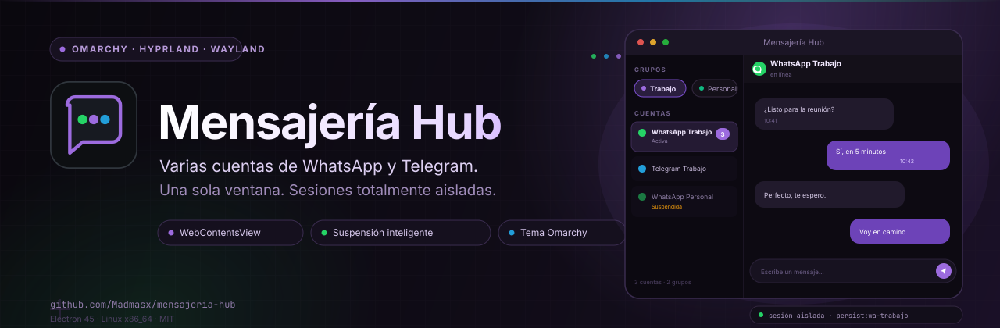
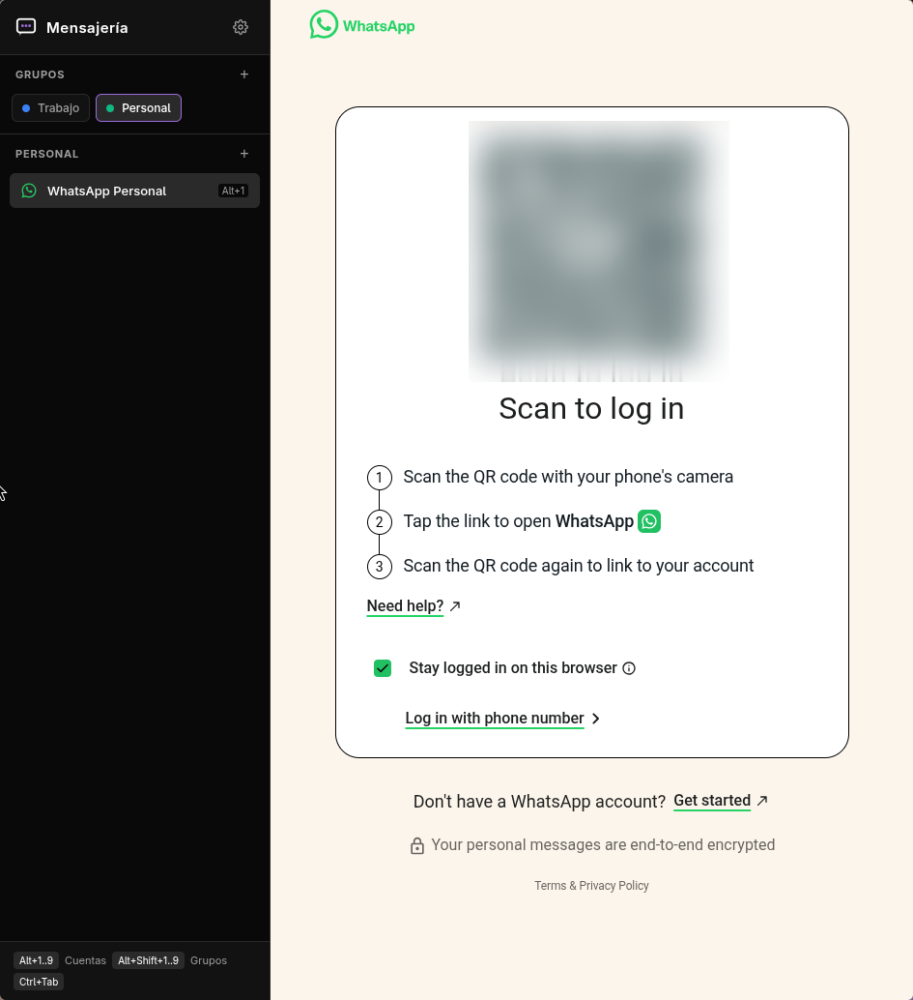
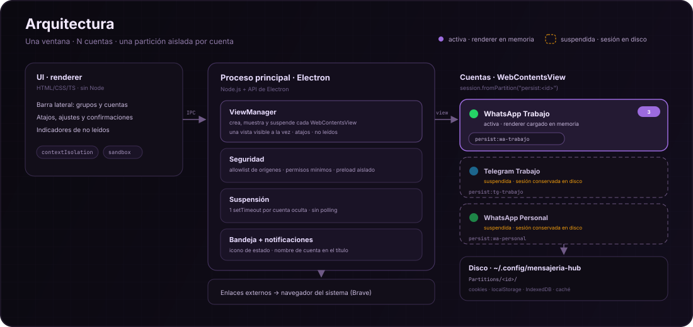

<div align="center">
  
  <br><br>
  
  <br><br>
  <a href="https://github.com/Madmasx/mensajeria-hub/releases/latest"><strong>⬇️ Descargar Linux AppImage / Windows .exe</strong></a>
</div>

**Varias cuentas de WhatsApp y Telegram. Una sola ventana. Sesiones totalmente aisladas.**
Grupos de contexto, suspensión inteligente, notificaciones con el nombre de la cuenta y tema
de Omarchy — sin polling y sin mezclar sesiones.

Aplicación de escritorio para Linux (Arch / Omarchy / Hyprland / Wayland) que reúne varias
cuentas de **WhatsApp Web** y **Telegram Web** en una sola ventana, separadas en **grupos**
de contexto (Trabajo, Personal…) con sesiones completamente aisladas.

> **Estado:** auditado, corregido y verificado en este equipo el **2026-11-07** sobre
> Omarchy 4.0.4, Hyprland 0.57.1, Electron 45.2.3 y Node 26.13. Los resultados de las
> pruebas están en [`docs/AUDITORIA.md`](docs/AUDITORIA.md).

---

## Captura

<p align="center">
  
</p>

---

## Qué hace

- **Grupos y cuentas**: crear, renombrar, reordenar y eliminar grupos y cuentas desde la UI.
- **Sesiones aisladas**: cada cuenta usa `session.fromPartition("persist:<id>")`. Nunca se
  comparten cookies, localStorage, IndexedDB ni caché entre cuentas.
- **Una ventana, muchas vistas**: `WebContentsView` (no el obsoleto `BrowserView`).
- **Cambio rápido**: la cuenta activa se muestra al instante; las cuentas usadas hace poco
  quedan cargadas en memoria y se **suspenden** tras X minutos sin uso (vista descargada,
  sesión intacta en disco) y se recargan al activarlas.
- **No leídos**: se lee el título de la página (`(3) WhatsApp` / `Telegram (3)`) y se muestra
  el contador por cuenta y el total del grupo en la barra lateral.
- **Notificaciones nativas**: con el nombre de la cuenta en el título; al hacer clic se abre
  esa cuenta. Enlaces externos se abren en el navegador del sistema (Brave aquí).
- **Descargas**: se guardan en `~/Descargas` (o `~/Downloads` / carpeta XDG) con nombre único
  y aviso al terminar.
- **Bandeja del sistema**: cerrar la ventana puede ocultarla a la bandeja; el icono cambia
  cuando hay mensajes sin leer. Si el sistema no tiene bandeja, la app cierra normalmente en
  vez de quedar inaccesible.
- **Tema de Omarchy**: lee los colores del tema aplicado (Omarchy 4 los guarda en
  `$XDG_STATE_HOME/omarchy/current/theme/colors.toml`).
- **Restauración**: al abrir vuelve al grupo y cuenta activos guardados en `config.json`.

---

## Stack

| Pieza | Versión / decisión |
|---|---|
| Electron | 45.2.3 (estable) |
| TypeScript | 5.7 + esbuild para main/preload |
| Renderer | Vite 6 (HTML/CSS/TS, sin framework) |
| Vistas de cuenta | `WebContentsView` + sesiones `persist:<id>` |
| Configuración | JSON en `~/.config/mensajeria-hub/config.json` (o `$XDG_CONFIG_HOME`) |
| Empaquetado | electron-builder → AppImage / directorio local |

Requisitos: Arch Linux (o derivado), sesión Wayland (probado en Hyprland) o X11, Node 20+ y
`npm`. Electron se instala como dependencia local del proyecto; no se instala nada global.

---

## Instalación rápida

```bash
git clone git@github.com:Madmasx/mensajeria-hub.git
cd mensajeria-hub
npm install                  # instala Electron/electron-builder (solo en el proyecto)
npm run build                # compila main, preload y renderer en dist/
./scripts/install-desktop.sh # crea ~/.local/bin/mensajeria-hub, .desktop e iconos
mensajeria-hub               # o búscalo en el lanzador como "Mensajería Hub"
```

> **Sesiones**: el repositorio **no** contiene cookies, config ni particiones de WhatsApp/Telegram.
> Todo eso se guarda en `~/.config/mensajeria-hub/` (fuera del repositorio y excluido por
> `.gitignore`). En un equipo nuevo hay que escanear el QR de cada cuenta una vez.

Para desarrollo con recarga del renderer:

```bash
npm run build && npx electron .
```

Comandos útiles:

```bash
npm run typecheck   # tsc --noEmit
npm run smoke       # prueba automatizada (requiere sesión gráfica; ver más abajo)
npm run dist        # AppImage en release/
npm run dist:dir    # binario local en release/linux-unpacked/
```

---

## Uso

1. La barra lateral izquierda lista **Grupos**; debajo, las cuentas del grupo activo.
2. `+` junto a GRUPOS crea un grupo (nombre + color).
3. `+` junto a CUENTAS añade una cuenta: servicio (WhatsApp/Telegram), nombre y grupo.
   La primera vez hay que escanear el QR dentro de la vista de esa cuenta.
4. Clic derecho (o `⋮`) sobre un grupo/cuenta abre las opciones: editar, mover y eliminar.
   Editar una cuenta permite cambiar nombre, URL y **moverla a otro grupo**.
5. El indicador `💤 Suspendida` aparece cuando la vista se descargó de memoria (la sesión
   sigue guardada en disco). Al hacer clic se recarga.
6. Eliminar una cuenta pide confirmación y borra su partición en disco
   (`<config>/mensajeria-hub/Partitions/<id>`). **Es irreversible.**
7. Eliminar un grupo **no borra sesiones**: mueve sus cuentas al primer grupo restante. Si es
   el único grupo y tiene cuentas, se rechaza para no perderlas.
8. Ajustes (engranaje): minutos de suspensión, cerrar a la bandeja, **atajos editables**,
   ruta de `config.json`, tema detectado y versión. Los atajos se validan y se aplican al
   pulsar Listo. También hay botón para abrir `config.json` con el editor del sistema.

---

## Atajos de teclado

Los valores salen de `config.json → shortcuts`; la UI los muestra formateados.

| Ajuste | Por defecto | Acción |
|---|---|---|
| `accountPrefix` | `Alt` | `Alt+1..9` cambia de cuenta dentro del grupo activo |
| `groupPrefix` | `Alt+Shift` | `Alt+Shift+1..9` cambia de grupo |
| `nextAccount` | `Ctrl+Tab` | siguiente cuenta del grupo |
| `prevAccount` | `Ctrl+Shift+Tab` | cuenta anterior del grupo |

Detalles de implementación:

- Los dígitos se leen de `input.code` (`Digit1..Digit9`), no de `input.key`, para que
  `Alt+Shift+1` funcione aunque esa combinación produzca `!` en la distribución del teclado.
- Los atajos funcionan con el foco en la barra lateral **y** dentro de WhatsApp/Telegram; el
  evento se intercepta en `before-input-event` y se hace `preventDefault()` cuando se maneja.
- Se pueden cambiar desde **Ajustes → Atajos**; se validan, se guardan en `config.json` y se
  aplican al instante (sin reiniciar). Los prefijos de cuenta y grupo deben ser distintos.
- También puedes editar `config.json` a mano; en ese caso la app los lee al arrancar y repara
  valores inválidos o conflictivos usando los predeterminados.

---

## Configuración (`config.json`)

Ruta: `$XDG_CONFIG_HOME/mensajeria-hub/config.json` → por defecto
`~/.config/mensajeria-hub/config.json`. La misma carpeta es el `userData` de Electron, así que
las particiones viven en `~/.config/mensajeria-hub/Partitions/<id>`.

```json
{
  "groups": [
    { "id": "trabajo",  "name": "Trabajo",  "color": "#3b82f6", "accounts": ["wa-trabajo", "tg-trabajo"] },
    { "id": "personal", "name": "Personal", "color": "#10b981", "accounts": ["wa-personal"] }
  ],
  "accounts": [
    { "id": "wa-trabajo",  "name": "WhatsApp Trabajo",  "service": "whatsapp", "url": "https://web.whatsapp.com" },
    { "id": "tg-trabajo",  "name": "Telegram Trabajo",  "service": "telegram", "url": "https://web.telegram.org/k/" },
    { "id": "wa-personal", "name": "WhatsApp Personal", "service": "whatsapp", "url": "https://web.whatsapp.com" }
  ],
  "activeGroup": "trabajo",
  "activeAccount": "wa-trabajo",
  "suspendAfterMinutes": 10,
  "closeToTray": true,
  "shortcuts": {
    "accountPrefix": "Alt",
    "groupPrefix": "Alt+Shift",
    "nextAccount": "Ctrl+Tab",
    "prevAccount": "Ctrl+Shift+Tab"
  }
}
```

Notas:

- `service` solo admite `whatsapp` o `telegram`. `url` debe pertenecer al origen oficial
  (`https://web.whatsapp.com` o `https://web.telegram.org`); si es inválida se usa la URL por
  defecto del servicio.
- `suspendAfterMinutes` admite decimales (por ejemplo `0.2` para probar); la UI limita a
  `1–120`.
- Los IDs se sanean (`[A-Za-z0-9_-]`) porque se usan como nombre de partición/carpeta. No
  pongas rutas ni credenciales aquí: la autenticación vive solo en la partición de Electron.
- La configuración se guarda de forma atómica (`tmp` + `rename`) y se repara al cargar:
  IDs duplicados, cuentas huérfanas, grupos vacíos y valores fuera de rango.
- Variables de entorno útiles para pruebas/empaquetado: `MENSAJERIA_HUB_CONFIG_DIR`,
  `MENSAJERIA_HUB_DOWNLOADS_DIR`, `MENSAJERIA_HUB_DEBUG=1`,
  `MENSAJERIA_HUB_SUPPRESS_EXTERNAL_OPEN=1`.

---

## Suspensión y memoria

- Al cambiar de cuenta, la vista anterior se oculta y se programa **un único `setTimeout`**
  (no hay `setInterval` ni polling). Cuando vence, se quita la vista del árbol y se cierra su
  `WebContents`: el proceso de renderer desaparece, pero cookies/IndexedDB/caché quedan en la
  partición de disco.
- Al reactivar la cuenta se crea una vista nueva sobre la misma partición; no hay que volver
  a escanear el QR.
- Chromium mantiene vivo el *service worker* de una cuenta cerrada hasta su timeout de
  inactividad (~30–60 s en la práctica). Por eso, justo después de suspender puede quedar
  algún proceso auxiliar; pasados unos segundos solo quedan la UI y la cuenta activa. Esto es
  comportamiento de Chromium, no un bucle de la app.
- Los contadores de no leídos de cuentas suspendidas se conservan hasta que el título cambie.

---

## Arquitectura

<p align="center">
  
</p>

Una única ventana con una **vista activa**; cada cuenta conserva su propio
`WebContentsView` y su partición `persist:<id>`. Al suspender se cierra la vista (el proceso
de renderer desaparece) pero la partición sigue en disco, por lo que al reactivar no hay que
volver a iniciar sesión.

---

## Seguridad

- Todas las vistas usan `contextIsolation: true`, `sandbox: true`, `nodeIntegration: false`.
  Comprobado desde la propia página: `process` no existe y `window.api` no está expuesto.
- El **preload de cuenta** es mínimo: instala un puente de `Notification` (mundo principal,
  vía `webFrame.executeJavaScript`) que reenvía título/cuerpo al proceso principal y **no**
  lee ni modifica el DOM de los chats. El contador no leídos se obtiene en el proceso
  principal desde `page-title-updated`, sin inyectar nada.
- Navegación: solo se permite el origen oficial de cada servicio. Cualquier otro destino
  (`will-navigate`, `will-redirect`, `window.open`) se bloquea y se abre en el navegador del
  sistema si es `http(s)`; protocolos como `javascript:`, `file:` o `data:` se rechazan.
- Permisos de sesión: solo `notifications` y `fullscreen` (y únicamente para el origen del
  servicio). Cámara, micrófono, geolocalización, etc. se deniegan.
- Descargas: se sanean nombres y se evita sobrescribir archivos existentes.
- `config.json` no contiene credenciales: las sesiones las gestiona Electron en la partición.
- La UI local no puede navegar ni abrir ventanas (`will-navigate` bloqueado, `setWindowOpenHandler`
  deniega) y tiene una CSP que solo permite recursos locales.

---

## Rendimiento medido (2026-11-07, este equipo)

| Métrica | Resultado | Cómo se midió |
|---|---|---|
| Arranque en frío (6 cuentas, solo la activa se carga) | **~225 ms** hasta `window-shown`; perfil real con 2 cuentas: **197 ms** | `MENSAJERIA_HUB_DEBUG=1`, `process.uptime()` |
| Arranque AppImage | **~1.28 s** hasta `window-shown` (incluye montaje FUSE) | igual |
| Cambio entre cuentas ya cargadas | **0.1–0.6 ms** en el proceso principal; 2–5 ms ida/vuelta IPC+DOM | logs `[timing] activate … created=false` y CDP |
| 6 cuentas visitadas | solo la activa mantiene su `WebContents` cargado tras el timeout; 5 marcadas `💤 Suspendida` | `getDiagnostics()` |
| Memoria tras suspender | ~1.0 GB sumando Browser/GPU/Network/UI + cuenta activa (pico ~2.2 GB con 4–6 cargadas) | `app.getAppMetrics()` |
| Timers de fondo | 1 `setTimeout` por cuenta oculta; **0 `setInterval`** | revisión de código |

El arranque no espera a WhatsApp/Telegram: se muestra la UI primero y la cuenta activa se
carga en su vista. Las demás no se crean hasta que se usan.

---

## Integración con Omarchy / Hyprland

### Lanzador

`scripts/install-desktop.sh` instala:

- `~/.local/bin/mensajeria-hub` (wrapper que ejecuta Electron con el proyecto y
  `--ozone-platform-hint=auto`).
- `~/.local/share/applications/mensajeria-hub.desktop` con
  `StartupWMClass=mensajeria-hub` (la clase real de la ventana, verificada con
  `hyprctl clients` tanto en desarrollo como en AppImage).
- Iconos en `~/.local/share/icons/hicolor/{scalable,256x256}/apps/mensajeria-hub.*`.

### Regla de ventana (opcional, NO se aplica automáticamente)

Omarchy 4 usa configuración Lua. Añade esta línea al final de tu sección personal en
`~/.config/hypr/hyprland.lua` (o en un módulo que cargues con `require`):

```lua
-- Mensajería Hub en el workspace 2 y flotante (ajusta o quita size/center si no lo quieres flotante)
o.window("mensajeria-hub", {
  workspace = "2",
  float = true,
  size = { 1280, 850 },
  center = true,
})
```

Alternativa con la API de Hyprland (misma sintaxis de reglas que usa Omarchy internamente):

```lua
hl.window_rule({
  match = { class = "^(mensajeria-hub)$" },
  workspace = "2",
  float = true,
  size = { 1280, 850 },
  center = true,
})
```

Comprueba que la clase coincide con:

```bash
hyprctl clients -j | jq '.[] | select(.class=="mensajeria-hub")'
```

**No se han modificado** tus archivos de Hyprland/Omarchy: la regla es solo una propuesta en
este README, como pediste.

---

## Empaquetado

```bash
npm run dist       # release/mensajeria-hub-<version>-x86_64.AppImage
npm run dist:dir   # release/linux-unpacked/mensajeria-hub (binario local)
```

El AppImage se probó en este equipo: arranca, muestra la UI, usa la clase `mensajeria-hub` y
lee la configuración del usuario. electron-builder descarga Electron/appimage-tool la primera
vez (requiere red); el icono empaquetado está en `resources/icon.png` (512×512) y viaja como
`resources/icon.png` dentro del paquete.

---


### Windows (experimental)

```bash
npm run dist:win
```

Genera en `release/`:

- `mensajeria-hub-<versión>-x64.exe` — **portable**, un solo ejecutable (no requiere instalación).
- `mensajeria-hub-<versión>-x64.zip` — carpeta portátil completa.

Notas:

- Se compila desde Linux con electron-builder; el `.exe` es Windows x64 (probado a nivel de build y estructura PE, **no ejecutado en una máquina Windows real**).
- No está firmado: Windows SmartScreen mostrará el aviso habitual de "editor desconocido".
- En Windows no existe la integración con Omarchy/Hyprland: usa el tema oscuro propio y la bandeja estándar.
- La configuración y las particiones de sesión se guardan en `%APPDATA%\mensajeria-hub`.


## Verificación reproducible

```bash
npm run typecheck
npm run smoke   # arranca una instancia aislada con XDG_CONFIG_HOME temporal y comprueba
                # UI, seguridad, no leídos, suspensión, cambios de cuenta y borrado de sesión
```

El script `smoke` necesita una sesión gráfica (Wayland o X11) y conexión a
`web.whatsapp.com` / `web.telegram.org`; usa un puerto CDP aleatorio, un `XDG_CONFIG_HOME`
temporal y `MENSAJERIA_HUB_SUPPRESS_EXTERNAL_OPEN=1` para no abrir pestañas en Brave.

La matriz completa de requisitos del encargo original, con evidencia y defectos corregidos,
está en [`docs/AUDITORIA.md`](docs/AUDITORIA.md).

---

## Limitaciones conocidas

- WhatsApp/Telegram Web pueden cambiar su título o su política de sesión; el contador depende
  del formato `(n)` en el título.
- Las llamadas de audio/vídeo no están soportadas (los permisos de cámara/micrófono están
  denegados a propósito).
- Las notificaciones dependen del *shim* de `Notification` y del servicio de notificaciones
  del escritorio; si el servicio no está activo no se verán.
- El service worker de una cuenta cerrada puede tardar hasta ~1 minuto en terminar (Chromium).
- El clic en la notificación nativa abre la cuenta, pero el clic no se propaga a la web (el
  foco de la conversación concreta lo gestiona el propio cliente web).
- Eliminar una cuenta o una sesión es irreversible.

---

## Estructura

```
src/main/index.ts          # ventana, IPC, atajos, bandeja, ciclo de vida
src/main/view-manager.ts   # WebContentsView, particiones, suspensión, unread, descargas
src/main/config.ts         # esquema, validación/reparación y guardado atómico
src/main/theme.ts          # lectura del tema de Omarchy (state dir + fallback)
src/main/paths.ts          # icono/descargas
src/preload/index.ts       # API segura de la UI
src/preload/account.ts     # puente mínimo de notificaciones
src/renderer/              # UI (HTML/CSS/TS)
scripts/install-desktop.sh # lanzador .desktop, wrapper e iconos
scripts/smoke-test.cjs     # prueba automatizada
```

---

<p align="center">
  <a href="https://github.com/Madmasx">
    
  </a>
  <br>
  <sub>Creado por <a href="https://github.com/Madmasx">Madmasx</a> · <a href="https://x.com/Madmasx">@Madmasx</a></sub>
</p>
